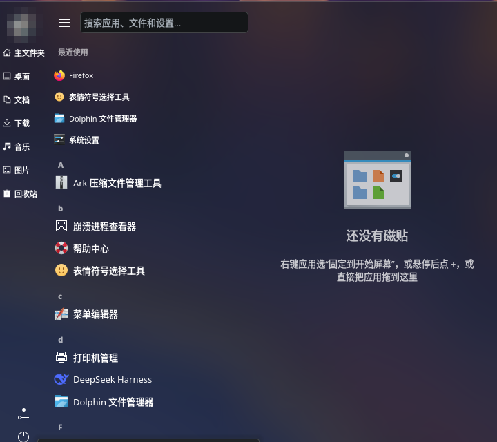

# WinStart — Windows 10 风格开始菜单（KDE Plasma 6）

Windows 10 风格的 Plasma 6 开始菜单替代组件，纯 QML，无 C++ 编译。

布局：左侧文件夹竖栏 + 中间应用列表（字母/分类两种模式）+ 右侧磁贴区；
≡ 可切换成两栏 + 整条底部栏的紧凑布局。



## 安装 / 升级 / 卸载

```bash
# 安装
kpackagetool6 --type Plasma/Applet --install win10-start

# 修改后升级（推荐用附带脚本，会顺带清 QML 缓存并重启 plasmashell）
./reload.sh

# 或者手动：
kpackagetool6 --type Plasma/Applet --upgrade win10-start
rm -rf ~/.cache/plasmashell/qmlcache
systemctl --user restart plasma-plasmashell.service

# 卸载
kpackagetool6 --type Plasma/Applet --remove org.qianshi.win10start
```

安装后重启 plasmashell（或注销重登），然后在面板上右键 →「显示替代方案」→「Win10 开始菜单」；
也可以右键面板 →「添加组件」里搜索「Win10 开始菜单」。

回滚：面板右键 →「显示替代方案」→ 选回「应用程序启动器（Kickoff）」。

## 使用

- **固定应用**：在左侧应用列表里右键 →「固定到开始屏幕」，磁贴会加到当前选中的分组。
- **固定文件夹**：在左侧文件夹栏右键 →「固定到开始屏幕」，会生成一个文件夹磁贴。
- **磁贴菜单**：右键磁贴 → 打开 / 小·中·宽·大 / 取消固定。
- **拖拽排序**：按住磁贴拖动，拖到同组另一个磁贴的位置可以换位，拖到另一个分组可以移组。
- **选中分组**：点分组标题选中（不做视觉高亮，但会记住选择）。右键应用「固定到开始屏幕」会加到当前选中的分组。
- **拖拽添加**：把应用从列表拖到某个分组区域松手，就加到那个分组；拖到空白处则加到当前选中的分组。
- **分组**：右侧磁贴区右上角 `+` 新建分组，`⋮` 重命名或删除分组。
- **搜索**：顶部搜索框输入即搜（KRunner 结果：应用、设置、计算器、单位换算）。
- **最近使用**：在应用列表顶部，跟随列表一起滚动（往上滚会消失）。
- **分类模式**：系统设置 → 本组件配置 →「应用列表显示方式」选「自定义分类」；分类来自 XDG 菜单（kmenuedit 的自定义分类会生效），点分类进入，左上角「←」返回。
- **布局切换**：标题栏左侧 ≡ 在两种布局间切换——
  - 展开：最左是竖向文件夹栏（用户/文件夹/设置/电源）；
  - 收起：文件夹栏隐藏，底部出现一条整栏——左边圆形头像、紧挨着文件夹，最右边是设置和电源。
  选择会记住。
- **用户/电源**：展开时在左侧竖栏（头像/齿轮/电源），收起时在底部栏右侧。

## 配置项

| 配置 | 说明 | 默认 |
| --- | --- | --- |
| 应用列表显示方式 | 字母排序 / 自定义分类 | 字母排序 |
| 显示“最近使用” | 左栏顶部最近使用列表 | 开 |
| 始终显示左侧文件夹栏 | 关闭后 ≡ 可收起 | 开 |
| 磁贴大小 | 磁贴单位尺寸（36–64） | 48 |
| 弹窗高度 | 弹窗像素高度（宽度固定 690） | 860 |
| 选中分组 | 记住上次操作的分组 | 0 |

配置存储：`~/.config/plasma-org.kde.plasma.desktop-appletsrc` 中本组件的 `[Configuration]` 段；
磁贴布局以 JSON 存在 `tileLayout` 键里。

## 已知限制（v0.1）

- 动态磁贴（时钟/媒体/系统负载）未实现。
- 拖拽排序没有做自动滚动（磁贴很多、拖到边缘时不会自动翻页）。
- 依赖 Plasma 私有 QML 模块 `org.kde.plasma.private.kicker`（Kickoff/Kicker 同样在用），
  Plasma 大版本升级时可能需要跟进。
- 启动应用走 kicker 的 favorites 模型；如果手动清空过 KDE 收藏，磁贴会在下次点击时自动补回。

## 开发调试

```bash
# 独立窗口预览（需要 plasma-sdk；把 -a 换成装好的插件名）
plasmoidviewer -a org.qianshi.win10start -f planar -s 720x640

# 看 QML 报错
journalctl --user -b | grep -i qianshi
```

plasmoidviewer 对面板类启动器只显示紧凑表示，因此本组件在桌面（planar）形态下会把完整界面
作为紧凑表示铺开，方便预览；面板里仍然是图标 + 弹窗。

## 文件结构

```
metadata.json
contents/
  config/main.xml        # 配置项定义
  config/config.qml      # 配置界面
  ui/main.qml            # PlasmoidItem + 面板图标
  ui/FullRepresentation.qml  # 三栏主体 + 模型
  ui/AppListView.qml     # 应用列表（字母分组/分类钻取共用）
  ui/SearchResultsView.qml
  ui/Rail.qml            # 左侧文件夹栏
  ui/UserPowerRow.qml    # 文件夹栏收起时的用户/电源行
  ui/TileArea.qml        # 磁贴区（分组/尺寸/持久化）
  ui/WinTile.qml         # 单个磁贴
```

## 附带组件：显示桌面（细条）

`show-desktop/` 是一个独立的小组件，提供 Windows 风格的面板细条：点击显示/恢复桌面，外观是一条 2px 的竖线（竖向面板时是横线）。

它用一个小型 C++ QML 插件调用 KWin 的 `org.kde.KWin.showDesktop`，因为 Plasma 6 的 QML 侧没有可直接调用的 DBus 客户端。

### 构建（NixOS）

```bash
./build-show-desktop.sh
```

脚本会自动进入项目 `shell.nix` 的编译环境（Qt 6.11 + cmake + ninja），编译完成后安装到：

```
~/.local/share/plasma/plasmoids/org.qianshi.showdesktop/
```

然后在面板“添加小组件”里搜索“显示桌面（细条）”。

### 构建依赖

- `shell.nix`：cmake、ninja、gcc、pkg-config、qt6.qtbase、qt6.qtdeclarative
- 通用工具也可以用 `nix profile add nixpkgs#cmake nixpkgs#ninja nixpkgs#gcc nixpkgs#pkg-config` 装到用户 profile，Qt 依赖仍建议留在 `shell.nix` 里保持版本一致。
